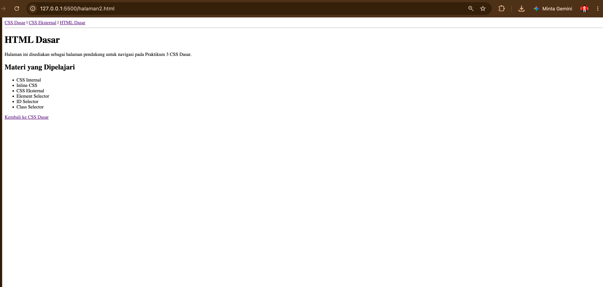
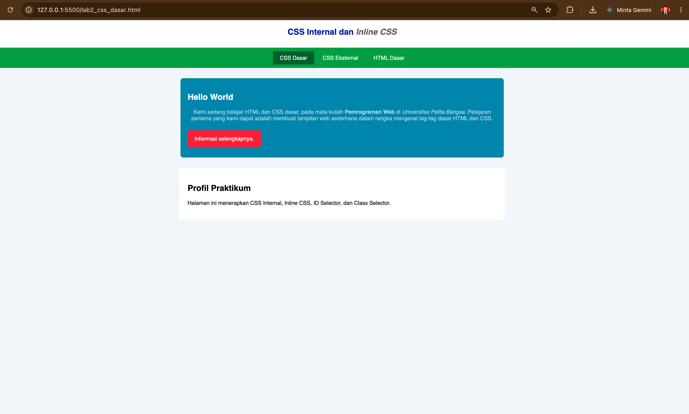
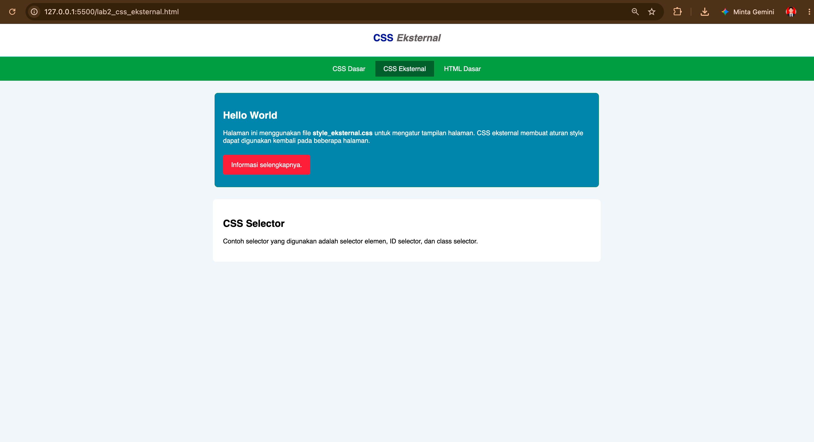

# Lab3Web – Praktikum 3 CSS Dasar

**Nama:** Guruh Khaerullah Kusvhi  
**NIM:** 312310630  
**Kelas:** I231C – Teknik Informatika

## Struktur Repository

```text
Lab3Web/
├── lab2_css_dasar.html
├── lab2_css_eksternal.html
├── halaman2.html
├── style_eksternal.css
├── images/
├── screenshots/
└── README.md
```

## Langkah Praktikum

### 1. Membuat dokumen HTML
Membuat file `lab2_css_dasar.html` dengan struktur dasar HTML dan halaman sederhana untuk mempelajari CSS.



### 2. Mendeklarasikan CSS Internal
Menambahkan CSS pada bagian `<head>` menggunakan tag `<style>`. CSS internal digunakan untuk mengatur font, header, heading, warna, dan tampilan halaman.



### 3. Menambahkan Inline CSS
Menambahkan deklarasi CSS secara langsung pada tag `<p>` menggunakan atribut `style` untuk mengubah posisi teks dan warna teks.


### 4. Membuat CSS Eksternal
Membuat file `style_eksternal.css`, kemudian menghubungkannya dengan dokumen HTML menggunakan tag `<link>`.



### 5. Menambahkan CSS Selector
Menerapkan ID Selector pada `#intro` dan Class Selector pada `.button` serta `.btn-primary`.


## Eksperimen CSS

Beberapa properti tambahan yang digunakan untuk memperjelas tampilan antara lain `margin`, `padding`, `background`, `border-radius`, `display`, dan `text-decoration`.

## Jawaban Pertanyaan

### 1. Lakukan eksperimen dengan mengubah dan menambah properti dan nilai pada kode CSS.

Eksperimen dilakukan dengan menambahkan `margin`, `padding`, `background`, `border-radius`, dan `display`. Perubahan tersebut membuat jarak antar elemen lebih teratur, tombol lebih mudah dibedakan, dan tampilan halaman lebih rapi.

### 2. Apa perbedaan pendeklarasian CSS elemen `h1 {...}` dengan `#intro h1 {...}`?

`h1 {...}` merupakan element selector sehingga aturan CSS berlaku pada seluruh elemen `<h1>` dalam halaman. Sedangkan `#intro h1 {...}` merupakan selector yang lebih spesifik karena hanya berlaku untuk elemen `<h1>` yang berada di dalam elemen dengan `id="intro"`. Jadi, jika keduanya memiliki properti yang sama, selector `#intro h1` memiliki prioritas lebih tinggi karena lebih spesifik.

### 3. Jika terdapat CSS internal, eksternal, dan inline pada elemen yang sama, mana yang ditampilkan?

CSS inline pada umumnya memiliki prioritas lebih tinggi daripada CSS internal maupun eksternal ketika deklarasinya memiliki tingkat kepentingan yang sama. Contoh:

```html
<style>
    p { color: blue; }
</style>
<link rel="stylesheet" href="style_eksternal.css">
<p style="color: red;">Teks ini berwarna merah.</p>
```

Pada contoh tersebut, teks akan tampil merah karena aturan inline lebih spesifik.

### 4. Jika sebuah elemen HTML memiliki ID dan Class, deklarasi mana yang ditampilkan?

ID selector memiliki specificity lebih tinggi daripada class selector. Contoh:

```html
<p id="paragraf-1" class="text-paragraf">Belajar CSS</p>
```

```css
.text-paragraf {
    color: blue;
}

#paragraf-1 {
    color: red;
}
```

Teks akan tampil merah karena selector ID lebih spesifik daripada selector class.

## Kesimpulan

Praktikum ini menunjukkan bahwa CSS dapat ditulis secara internal, eksternal, maupun inline. Selector digunakan untuk menentukan elemen yang akan diberi aturan CSS. ID selector lebih spesifik daripada class selector, sedangkan inline CSS mempunyai prioritas tinggi ketika tidak ada aturan lain seperti `!important` yang memengaruhinya.

## Catatan Screenshot

Folder `screenshots` disiapkan mengikuti format repository praktikum sebelumnya. Screenshot dapat diambil setelah masing-masing tahap dibuka melalui browser, kemudian disimpan menggunakan nama file yang sesuai dengan bagian README.
# Lab3Web
